# Experiment 5 – Neural Network Layers in CUDA

## Aim
Implement and test neural-network operations using custom CUDA kernels, then compare CPU and GPU forward-pass correctness and performance.

## Hardware and software used
- GPU: NVIDIA RTX 4500 Ada Generation
- NVIDIA driver: 610.47
- CUDA Toolkit: 13.4 (NVCC 13.4.92)
- Compiler: Microsoft Visual C++ Build Tools 2026 (x64 developer environment)
- CUDA compilation target used: `sm_89`
- Network dimensions: batch 256, input 128, hidden 64, output 10

> The commands below reflect the Windows setup used for this experiment. The `sm_89` target was used successfully on the test system.

## Repository contents
- `neural_network.cu` – CUDA and CPU implementation (add this source file from your experiment folder).
- `README.md` – experiment description, setup, commands, results, and screenshots.
- `.gitignore` – excludes generated executables and build artifacts.
- `ss/` – setup and execution screenshots.
- `results/` – recorded performance measurements in Markdown and CSV, plus copies of the performance graphs.

## Prerequisites
1. Windows 10/11 x64.
2. An NVIDIA CUDA-capable GPU and a compatible NVIDIA driver.
3. CUDA Toolkit installed; `nvcc` available on PATH.
4. Microsoft Visual C++ Build Tools with the x64 C++ compiler.
5. Git installed and a GitHub repository created.

## Setup and run the experiment

### 1. Verify the NVIDIA GPU
Open PowerShell or Command Prompt and run:

```powershell
nvidia-smi
```

### 2. Verify CUDA compiler
```powershell
nvcc --version
where.exe nvcc
```

### 3. Open the Visual Studio x64 developer environment
For the Build Tools installation used in this experiment:

```cmd
cmd.exe /k ""C:\Program Files (x86)\Microsoft Visual Studio\18\BuildTools\Common7\Tools\VsDevCmd.bat" -arch=amd64 -host_arch=amd64"
```

### 4. Change to the experiment directory
```cmd
cd /d "%USERPROFILE%\Documents\Experiment5_CUDA"
```

### 5. Compile the CUDA source
```cmd
nvcc -O2 -arch=sm_89 neural_network.cu -o neural_network.exe
```

### 6. Execute the experiment
```cmd
neural_network.exe
```

Run the executable again to collect additional measurements. Each program execution itself averages its CPU and GPU timings over 20 repetitions.

## Implemented operations
1. Matrix multiplication with bias: `C = A × B + bias`.
2. ReLU activation: replaces negative values with zero.
3. Sigmoid activation: maps values to the interval (0, 1).
4. Two-layer forward pass:
   - Input → matrix multiplication + bias → ReLU.
   - Hidden layer → matrix multiplication + bias → Sigmoid.

## Validation
The program tests each CUDA kernel and compares the CPU and GPU forward-pass outputs. All four recorded runs reported:
- Matrix multiplication + bias: **PASSED**
- ReLU: **PASSED**
- Sigmoid: **PASSED**
- Maximum absolute output difference: **0.000000**
- CPU and GPU outputs: **MATCH (within tolerance)**

## Performance observations

| Run | CPU time (ms) | GPU kernel-only (ms) | GPU end-to-end (ms) | Kernel-only speedup | End-to-end speedup |
|---:|---:|---:|---:|---:|---:|
| 1 | 0.717745 | 0.021043 | 0.091440 | 34.108168× | 7.849355× |
| 2 | 0.728520 | 0.031587 | 0.077320 | 23.063771× | 9.422142× |
| 3 | 0.720060 | 0.021248 | 0.084235 | 33.888366× | 8.548228× |
| 4 | 0.719140 | 0.043459 | 0.180730 | 16.547475× | 3.979085× |

The four runs show variation in timing, while all correctness checks remained successful. Kernel-only timing excludes host/device data transfers; end-to-end timing includes transfers and GPU execution.

### Execution-time graph
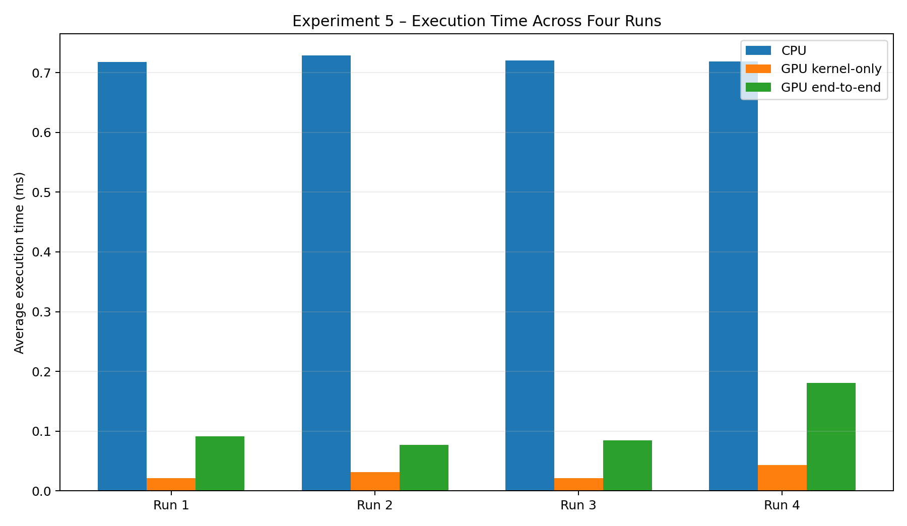

### Speedup graph
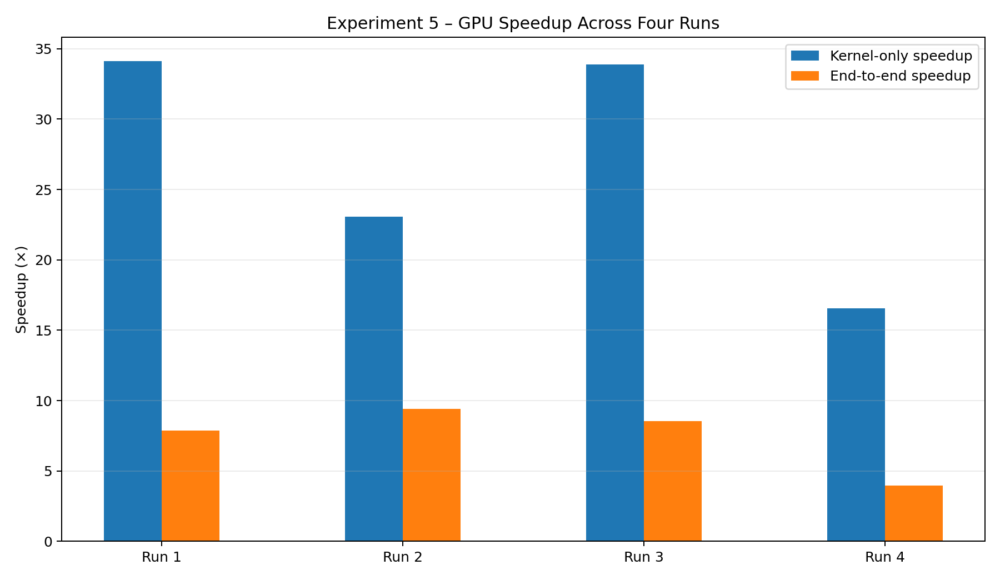

The complete measurement table is also available in [`results/performance_results.md`](results/performance_results.md) and as [`results/performance_results.csv`](results/performance_results.csv).

## Screenshots

### GPU and CUDA setup
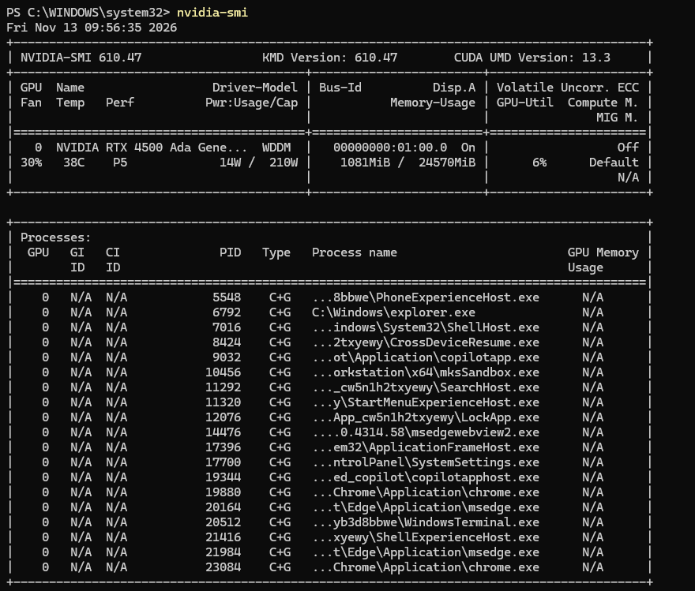
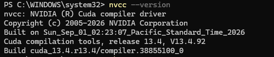
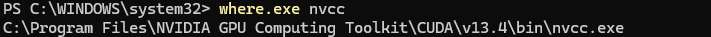
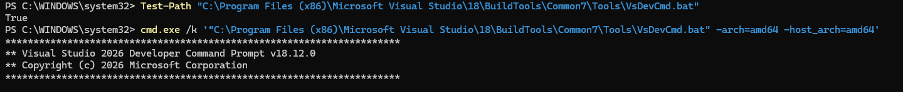
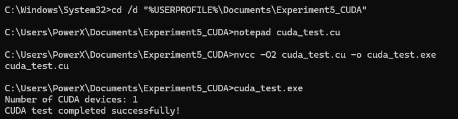
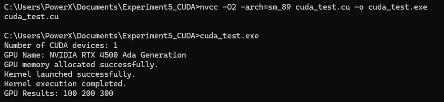

### Neural network execution
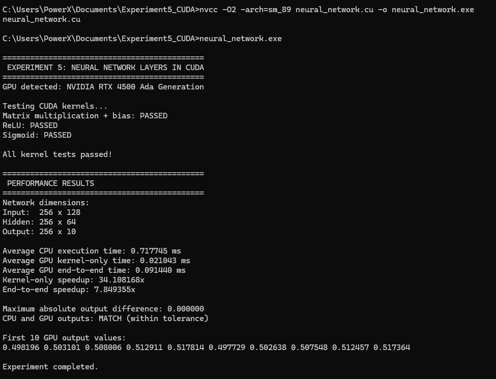
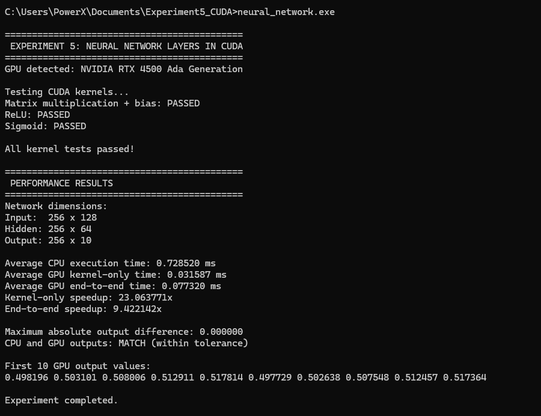
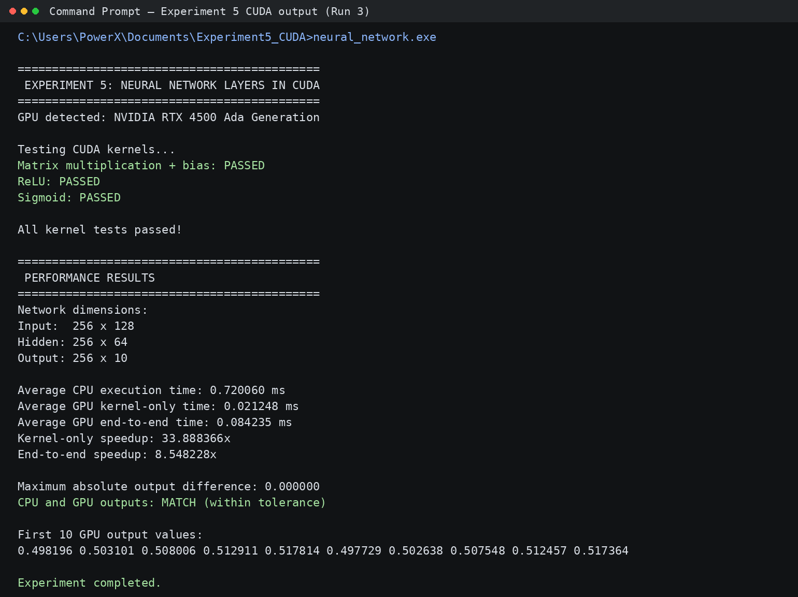
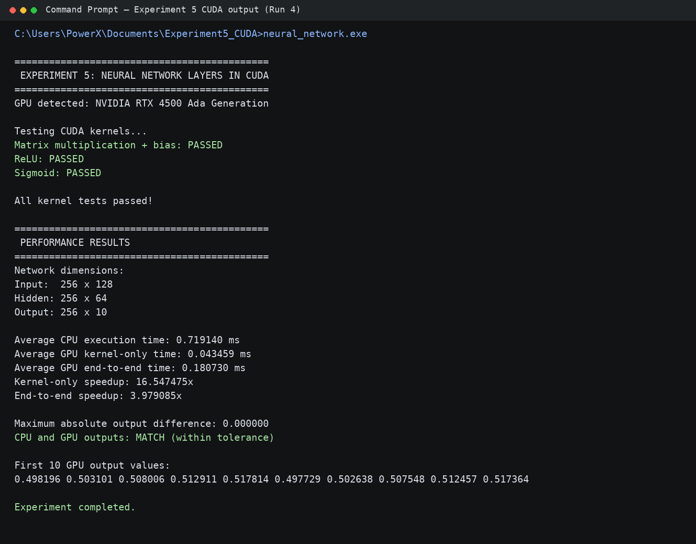

> Note: Runs 3 and 4 above are terminal-style images recreated from the console output pasted into the chat, not direct screen captures. Replace them with original terminal screenshots if your submission specifically requires unedited screenshots.

## Conclusion
The neural-network operations were implemented and tested successfully using CUDA. The CPU and GPU forward-pass outputs matched within the program's tolerance. The measurements demonstrate the GPU's speed advantage for the tested workload, while also showing that host/device transfer overhead affects end-to-end performance.

## Reproduce
From the Visual Studio x64 developer command prompt, navigate to the source directory, compile using the command above, and run `neural_network.exe`.
